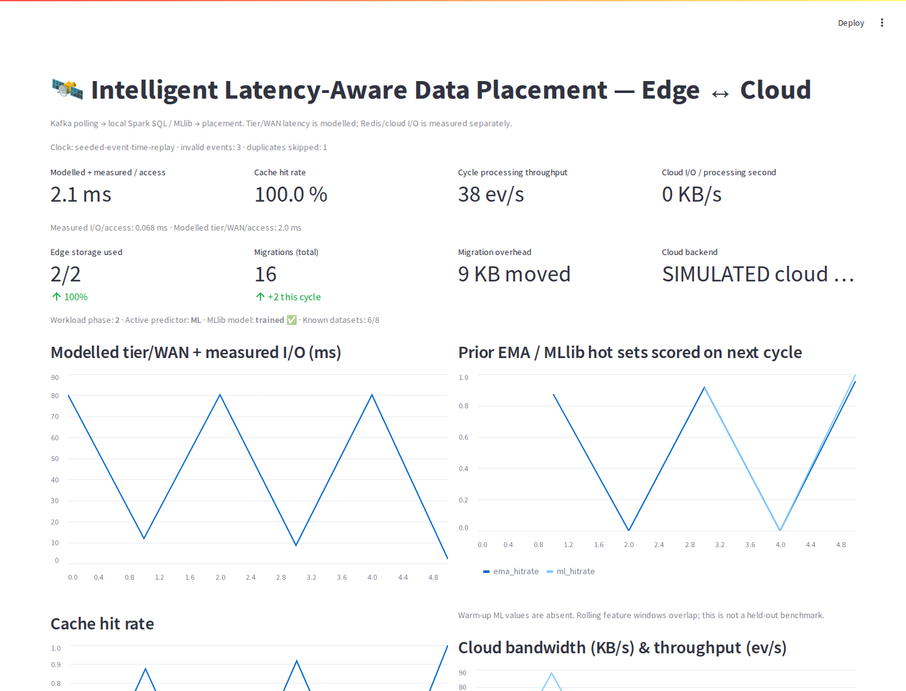

# Placement core: reproducible safety and integration

## Verified 12 November 2026 IST

[Clean-checkout CI](https://github.com/apoorvkumarvcd23-coder/Intelligent-Latency-Aware-Data-Placement-/actions/runs/43089970944)
passed on source `ea7669e7e63b9c550797595b19f11270fa272036`: 63 boundary tests,
compilation, both Compose configurations, actual Kafka/Spark MLlib/Redis replay,
and empty/populated Chromium dashboard checks. The [recorded JSON](core-demo-2026-11-12.json)
contains six cycles: 148 received, 144 accepted, three invalid and one duplicate.
The trace SHA-256 is `e4537409e61621a212b3e8b6585b3a6c5c3daa9a823f4a97628c39cdc52f9841`.



This screenshot comes from that CI browser, not a mockup. Cloud storage in this
run is explicitly simulated. HDFS policy failure injection is unit coverage;
actual HDFS integration, final core acceptance and a release tag remain pending.
These fixture scores and processing rates are not performance/generalization claims.

Python 3.10+ supports the unit suite without Spark, Kafka or Redis services:

```sh
python -m venv .venv
# Activate the environment, then:
python -m pip install -r requirements-dev.txt
python -m pytest -q
```

On Windows, if the system pytest temp directory is inaccessible, create
`artifacts/` and pass a fresh `--basetemp artifacts/check-<unique-name>`.
The symlink test may skip when Windows denies symlink creation; Linux CI runs it.

## Bounded actual-service replay

Docker Compose is required. This uses isolated Kafka, Redis, Java 17/PySpark
3.5.1 and the dashboard, with a disposable filesystem cloud. There is no exchange
data, model account, credential, employer code or external inference service.

```sh
python -c "from pathlib import Path; Path('artifacts').mkdir(exist_ok=True)"
docker compose -p placement-core -f compose.core-demo.yml build demo dashboard
docker compose -p placement-core -f compose.core-demo.yml up -d --wait kafka redis dashboard
docker compose -p placement-core -f compose.core-demo.yml run --rm demo
```

Open **http://127.0.0.1:8508**. Report: ignored `artifacts/placement-core.json`.
The replay uses eight one-KiB synthetic datasets, capacity two, seed 17, six
24-event cycles and three phases. It sends 144 valid requests, three malformed/
unsafe records and one exact duplicate through the real broker. The shared
live-engine event gate, Spark aggregation, MLlib training/prediction, placement,
Redis publisher and dashboard are exercised; no service/model adapter is mocked.
The report asserts 148 received = 144 accepted + 3 invalid + 1 duplicate, bounded
cache state, model readiness, changed placement and exact prior-prediction scores.

The clock is **historical event-time replay**, not a paced live workload or a
performance benchmark. The input trace hash is repeatable for the same config,
start time and run ID. Spark durations/floating-point coefficients are not claimed
byte-identical across machines. Kafka topic names are unique per run. The demo
explicitly resets only its own isolated Redis namespace; do not point it at a
personal Redis instance. Full-stack volumes/containers are separate from this demo.

Stop only this stack with:

```sh
docker compose -p placement-core -f compose.core-demo.yml down -v --remove-orphans
```

CI runs this clean-clone replay plus empty/populated browser checks. Its
`placement-core-evidence` artifact contains the actual JSON and PNG. The optional
browser script `--log-image` emits only the public-synthetic screenshot so an
agent can inspect that image through a text-only CI connector. No credentials or
private data are present in that page. A failed CI run is not completion evidence.

## Storage policy

- `simulated`: local dataset bytes plus a SHA-256 mirror manifest; no HDFS probe.
- `hdfs`: startup and operations require HDFS, with no local fallback dependency.
- `auto`: HDFS is preferred; only existing checksum-verified mirror bytes can be
  served during failure. Missing/corrupt bytes fail closed. Data written during
  fallback is uploaded and read back for verification before recovery switches
  to HDFS. Unexpected HDFS bytes do not overwrite an already verified mirror.

Auto mode assumes one application writer in its managed HDFS/mirror namespace.
It is not multi-writer synchronization. Mirror data/manifest use atomic file
replacement; a crash between replacements can leave a mismatch, which fails
closed. Broader crash/recovery drills are later gates. Initial legacy local files
without a manifest are not implicitly trusted. Use a fresh isolated demo store.
The deterministic seed verifies existing managed bytes and refuses a mismatch.

Dataset IDs must be canonical `ds_0001` style. Both storage and Redis boundaries
validate them. Local symlinks are rejected. Configuration rejects unknown keys,
bad enums, booleans-as-numbers, NaN/infinity and inconsistent budgets before opening
services. Total seed bytes are bounded to 256 MiB; edge bytes to 128 MiB.

## Event, cache and timing contracts

Version 1 events require event_id, dataset_id, finite timestamp, configured size
and nonnegative phase. Payloads are at most 4,096 bytes. The live consumer accepts
at most three rolling windows of age and five seconds of forward clock skew.
Invalid records persist only a reason and payload digest in a 100-record Redis
list. The per-process event-ID cache retains 10,000 IDs. Duplicates outside that
bound or after process restart may be observed again; there is no exactly-once claim.

Redis Lua updates dataset membership and bytes atomically and refuses new members
at capacity. Placement prefetches all source bytes before evicting old members, so
a failed source read leaves the old set intact. Reconciliation as a whole is not
a distributed transaction; one engine owns the namespace. Restart currently clears
its edge namespace and Kafka still uses auto-commit. Durable checkpoint/replay
semantics remain a later task. Clients and Spark are closed on normal interruption.

Every miss reads current cloud bytes; size-cache timing is not reused. The
dashboard separates measured Redis/cloud I/O from configured tier/WAN latency.
The combined number is a model plus measurement, not measured WAN latency. There
is no artificial WAN sleep. Throughput/bandwidth rates are normalized by decision
processing duration, not a distributed load benchmark. ML warm-up scores are
absent. Previous-cycle hot sets are scored on subsequent accepted events; rolling
feature/label windows overlap, so no held-out generalization claim follows.

## Remaining acceptance

The [CORE09 real HDFS/full-stack walkthrough](HDFS_INTEGRATION.md) now passes
with separate actual outage/recovery evidence. This earlier CORE06 profile and
its recorded report remain simulated storage.
Fair multi-seed/LRU benchmarks, persisted models, broader replay/recovery and full
v1 gates follow in December. Final core acceptance is still 17 November, with
no tag before its clean-clone/evidence audit. Local Docker failure must be repaired
for local container demos; clean Linux CI evidence does not claim that host repair.

## Configuration preflight — XL01

Validate configuration before starting containers. From the repository root,
install the existing pinned PyYAML dependency and run:

```sh
python -m pip install PyYAML==6.0.1
python -m common.check_config --config config/config.yaml
python -m common.check_config --config config/core-demo.yaml
python -m common.check_config --config config/core-hdfs.yaml
```

No Kafka, Spark, Redis, HDFS, NumPy, Streamlit or Docker installation/service is
needed for this preflight. Success prints JSON with the backend policy,
predictor, dataset/cache counts and synthetic payload sizes. It explicitly says
`connectivity: not checked`; sizes exclude metadata/runtime overhead and do not
prove available disk or memory. Failure exits 2 with no partial success JSON.

All three services and the CLI use the same loader. Selection order is explicit
`--config` (service callers use `load_config(path)`), then `PLACEMENT_CONFIG`,
then `/app/config/config.yaml` if present, otherwise repository
`config/config.yaml`. A selected unreadable/empty path fails; it never falls
back to a different file. Errors identify the validation rule without echoing
YAML source, credentials or file contents.

Files must be UTF-8 YAML mappings of at most 65,536 bytes with exactly the
supported sections/settings. Mapping keys must be unique at every level,
including keys introduced by YAML merges: an explicit override of a merged key
is rejected. Custom Python tags and malformed YAML fail. Numeric values must
be finite and within the declared bounds; booleans are not numeric settings.
The shared cross-field contract enforces `top_k <= capacity <= dataset count`,
hot-set size, decision interval/window, 256 MiB synthetic payload and 128 MiB
edge payload limits. HDFS endpoints remain credential-free HTTP; supplied
ports must be integers from 1 through 65,535.

Run only the isolated configuration suite in a fresh environment:

```sh
python -m venv .venv
.venv/bin/pip install pytest==8.4.1 PyYAML==6.0.1
.venv/bin/python -m pytest tests/test_config.py -q
```

On Windows use `.venv/Scripts/python.exe` and
`.venv/Scripts/pip.exe`. This suite blocks runtime imports while checking
the actual repository service loaders and runs actual preflight CLI processes
against the three profiles. CI performs this minimal-environment check before
installing the broader unit dependencies, then retains the existing full
real-service integration gates. Configuration validation alone does not prove
backend reachability or replace those gates.
